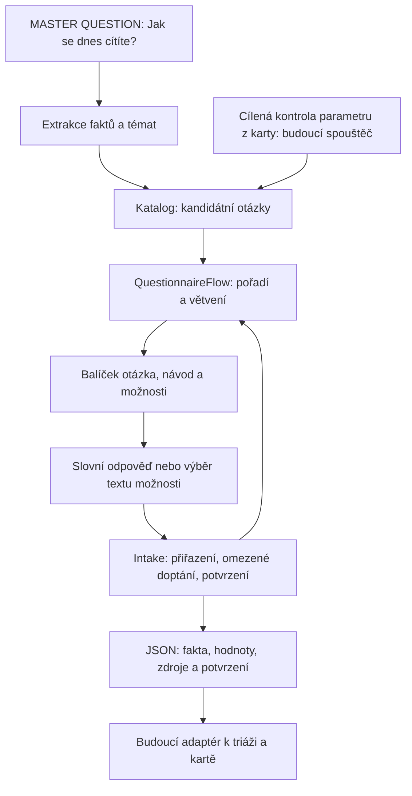
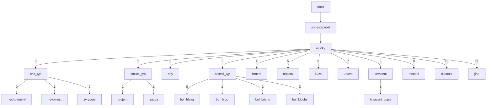

# Kontrola LLM modulu a průchod otázkami

16. 10. 2026. Rozsah této změny je sběr informací, větvení a předání dat.
MASTER QUESTION má nyní samostatný extraktor a návrh kandidátů z katalogu;
propojení s celým dialogem je další krok. Triáž, karta a časování patří
do navazujících komponent.

## Dohodnutý tok a skutečný stav



Dnes lze ručně zadat cílové otázky nebo projít celý dotazník přes stejný `Intake`.
[MASTER extraktor](../llm_intake/MASTER_CONTRACT.md) již poskytne kandidáty podle
faktů pro šest témat; jejich automatické propojení s celým dialogem, odstranění
již zodpovězených dotazů, rozpočet kontaktu a časování zatím neexistují.
Každá zpráva zůstává uchovaná a lze ji samostatně zpracovat extraktorem, včetně
informací mimo právě řešenou otázku. Cílené CLI jej zatím automaticky nevolá.

## Zjištění review

| Kontrola | Stav po úpravě |
| --- | --- |
| Otázka a možnosti jako jeden balíček | `Question.specification()` obsahuje text, návod, poznámku, směr škály, možnosti, pořadí a podmínku; používá jej model, katalog i nový export |
| Duplicitní definice v příkladech | Odstraněné kopie textů a možností; příklady drží ID, klient doplní stejný balíček ze zdrojových definic |
| Správné přiřazení odpovědi | Dosavadní validace hodnoty, citace, potvrzení a opravy zachovaná; přidaná kontrola výlučné možnosti „žádné účinky“ |
| Pomoc pacientovi | `/moznosti` vypíše přesné texty bez barev a indexů, bez API volání; prompt dovoluje krátké neutrální alternativy při doptání |
| Pořadí a větvení | Nový `QuestionnaireFlow` vychází ze seznamu a `podminka`; nevypočítává barvu |
| Nevyřešený rodič | Neaktivuje děti; stav `blocked` / `unresolved` je viditelný, konec seznamu neznamená automaticky úspěch |
| Odmítnutý návrh | Nový pipeline export má hodnotu null, zachová historii; starší snapshot intake v2 zůstává kompatibilní a vyžaduje kontrolu stavu |
| Napojení dále | `build_pipeline_packet()` tvoří samostatný JSON bez barev; žádné vazby na `triage.py`, databázi ani konkrétní CLI |

Rozdělení je malé: `core.py` obsahuje otázku a potvrzování, `client.py` transport
a sestavení promptu, `flow.py` pořadí a `pipeline.py` výstup. Není přidaný framework,
RAG ani runtime závislost. Limity doptání lze měnit v `Intake(max_clarifications=...)`
nebo CLI `--max-clarifications`; model, URL a autentizace zůstávají v prostředí.
Nyní není potřeba další abstrakce. Případné dělení `core.py` má smysl až při růstu.

## Posloupnost podle zdrojových definic

Zdroj: [dotazniky_definice.json](../rakathon_meddi_onco_data/docs/dotazniky_definice.json),
seznamy `otazky` a pole `podminka`. Čísla na hranách jsou **indexy od nuly**,
nikoli závažnost. U typu `vice` stačí, že je index mezi potvrzenými výběry.
Při více aktivních větvích rozhoduje pořadí otázek v souboru.

Celý dotazník `nezadouci_ucinky`:



Volba `ucinky:12` je „Nemám žádné nežádoucí účinky“ a neotevírá žádnou větev.
Nelze ji kombinovat s pozitivními volbami. Tato výlučnost není ve zdroji jako
strojové pole; malá politika v `core.py` ji označuje podle přesného textu,
index odvozuje z aktuálních možností. Při změně textu přestane načítání fungovat
výslovně místo přiřazení politiky jiné možnosti.

Další dotazníky zachovávají přesné pořadí ze zdroje:

- `psychoonkologicky_screening`: devět otázek bez podmíněných větví.
- `bolest_analgeticka_terapie`: `nrs → spokojenost → sos → nu`; `nu_jine` pouze
  při `nu:3`.
- `esas`: deset otázek bez podmíněných větví.

**Cílený režim:** `targets=["zvraceni"]` otevře přímo zvracení. Rodiče mimo
zvolený rozsah nevyžaduje ani za ně nevytvoří odpověď. Podřízené otázky stále
podléhají podmínkám: u `targets=["krvaceni"]` se `krvaceni_popis` položí až
po potvrzeném „Ano“. Je-li součástí rozsahu také rodič a jeho odpověď větev
popře, přímý cíl ji nepřebije. Historické údaje zatím průchod nenačítá.

## Python rozhraní a JSON

```python
from llm_intake import Intake, QuestionnaireFlow, build_pipeline_packet
from llm_intake.client import Client
from llm_intake.master_contract import MessageEvent

# Syntetický podnět kontaktu, nikoli odpověď na následný cílený dotaz.
event = MessageEvent(
    id="synthetic-contact", patient_id="synthetic-patient",
    text="Jsem unavený.", available_at="2026-10-16T10:00:00+02:00",
    source="master_question", author="patient", question="Jak se dnes cítíte?",
)
flow = QuestionnaireFlow("nezadouci_ucinky", targets=["unava"])
session = Intake(flow.next_question(), Client.from_env())
draft = session.submit("Odpočinek mi pomůže.")
# UI/CLI zde vyžádá kontrolu a explicitní potvrzení, případně opravu.
session.confirm()  # pouze pokud pacient skutečně potvrdil
flow.record(session)
packet = build_pipeline_packet(event, facts=[], sessions=flow.sessions)
```

Spouštěč z karty později předá stejné `targets` a metadata podnětu. Vyšší vrstva
volá `next_question()`, založí `Intake`, nechá jej skončit a předá jej `record()`.
Pro celý dotazník vynechá `targets`. `flow.snapshot()` vrací aktuální stav,
seznam připravených/přeskočených/blokovaných otázek a původní exporty intake.
Zatím nejde o automatický CLI průchod: CLI stále řeší jednu zvolenou otázku.

Nová obálka má `kind="llm_intake"`, `schema_version=1`, `message`, `facts`
a `question_answers`. [Úplný syntetický JSON](../llm_intake/pipeline_example.json)
ukazuje skutečný výstup funkce s ručně nahrazeným extraktorem.
Každá odpověď obsahuje celý balíček `question`, `state`, `confirmed`, `revision`,
`value`, slovní `answer`, `turns`, `evidence`, případný `follow_up`,
`unresolved_reason` a `metrics`. U možností je `value` index / seznam indexů od nuly;
u ostatních typů je to číslo nebo text. Návrh má `confirmed=false`.
Odmítnutý či nevyřešený návrh má hodnotu null, jeho původní sdělení se neztrácí.

`message` je původní podnět kontaktu. Citace odpovědi odkazuje přes `turn_index`
do vlastního `turns`, nikoli nutně do MASTER zprávy. Čas `available_at` patří
původní zprávě; časy jednotlivých tahů současný intake neměří a export je
nevymýšlí. Pro přehrávání skutečné časové historie je musí doplnit budoucí
adaptér událostí. Fakta zůstávají nepotvrzená nezávisle na potvrzené cílené odpovědi.

## Co zatím ověření nedokazuje

Automatické testy kontrolují strukturu a logiku, ne přesnost reálného LLM.
Prošlo 116 testů; nové testy pokrývají všech 49 otázek a větve čtyř dotazníků.
Upravený prompt byl ověřen dvěma živými syntetickými voláními přes stávající
bránu: „Únava a slabost, zadýchávání.“ → `[7, 10]` a „Nemám žádné nežádoucí
účinky.“ → `[12]`; oba výsledky byly nepotvrzené návrhy. Nejde o benchmark.
Následně přidaný MASTER extraktor již rozlišuje subjekt a popření při návrhu
kandidátů. Stále chybí řízení podle stáří a již známých hodnot a napojení
na celý rozhovor. Průchod neřeší naléhavost ani celkový limit
kontaktu. Známé rozpory NRS 0 vs. 1–10 a hranice průjmu jsou nadále otevřené
v [návrhu](master-question.md); zdrojové definice se nemění.

Při nejistotě se nepřiřadí horší možnost jako potvrzená zkušenost pacienta;
závažnost vyhodnotí další kód z doložených faktů a alternativ. Zdroj:
[pravidla](../rakathon_meddi_onco_data/docs/pravidla_triaze.md), oddíly 3 a 6.4.
Nový kontrakt ani diagram nepředstavují klinické ověření.

Prompt zachovává explicitní instrukce, příklady a striktní schéma. Technické
zdroje: [OpenAI Prompt engineering](https://developers.openai.com/api/docs/guides/prompt-engineering),
[Structured Outputs](https://developers.openai.com/api/docs/guides/structured-outputs?api-mode=chat),
ověřeno 16. 10. 2026. Validní JSON sám nedokazuje správný význam extrakce.
