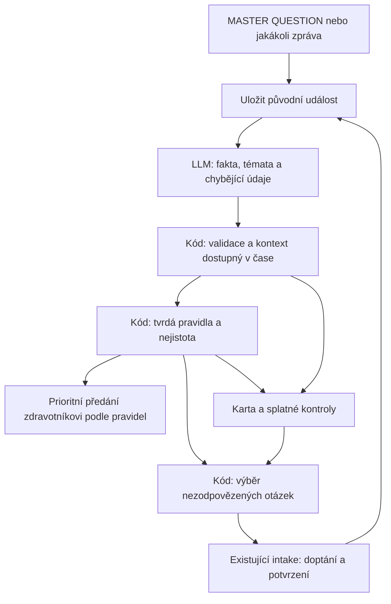

# MASTER QUESTION a propojení pipeline

Návrh k projití týmem, 16. 10. 2026. Z širšího návrhu už existuje první
[samostatný kontrakt, katalog a extraktor](../llm_intake/MASTER_CONTRACT.md);
orchestrace celého rozhovoru ještě neexistuje. Neměníme export intake v2
ani `triage.py`. Cíl: využít volný popis stavu,
vybrat minimum potřebných otázek a zachovat údaje pro časovou kartu a triáž.

## Co už máme a co zatím chybí

| Část | Skutečný stav | Důsledek pro další krok |
| --- | --- | --- |
| `llm_intake/` | Jedna vybraná otázka, slovní odpověď, přiřazení k možnosti, cílené doptání, potvrzení; export v2 | Zachovat jako samostatný dialog nad jedním parametrem |
| MASTER extraktor | `MasterExtractor` vytěžuje fakta, `analyze_message` navrhuje otázky pro šest namapovaných témat; bez triáže a potvrzení | Další krok je přenos již známých hodnot do intake a řízení celého kontaktu |
| Nejistota v intake | `unclear` má hodnotu null, po limitu vznikne `unresolved`; nejsou uložené možné alternativy | Z toho zatím nelze spočítat vyšší z reálně možných úrovní |
| `triage.py` | Jen horečka v kontextu chemoterapie, absolutní SpO2, pocit a bolest; `None` značí posouzení | Zvracení, krvácení, zimnice, trendy a většina tvrdých pravidel nejsou implementované |
| Definice otázek | 4 dotazníky, 49 otázek, ID se opakují mezi dotazníky; podmínky větvení | Vždy používat dvojici `questionnaire_id/question_id` a vlastní katalog vazeb |
| Propojení | Není společný adaptér, karta, plánovač ani zpracování libovolné zprávy | MASTER QUESTION nemá obcházet chybějící extrakci faktů a bezpečnostní vyhodnocení |

Vstup triáže je anglický připravený JSON. Intake vrací české klíče a výběry
možností. Mezi nimi bude malý explicitní adaptér; nepřejmenovávat kvůli tomu
oba moduly a neodvozovat triáž převodem barvy odpovědi na `Severity`.

## MASTER QUESTION je zdroj zprávy

„Jak se dnes cítíte?“ je konverzační vstup. Jeho odpověď patří do stejné vstupní
vrstvy jako spontánní zpráva a historické `checkiny[].zprava_pacienta`.
Historická zpráva ale není automaticky odpovědí na námi nově vytvořenou otázku.
Zachovat původ, autora i skutečně položenou otázku, pokud je známá.

Stejným zpracováním musí projít **každá** další odpověď. I během otázky na únavu
může pacient nově zmínit krvácení. Nesmí se zahodit jako údaj mimo danou otázku.
Jedna zpráva může obsahovat více problémů nebo informaci, pro kterou žádná
předdefinovaná otázka neexistuje. Žádný extrahovaný příznak se nesmí ztratit
jen proto, že nebyl v navrženém seznamu témat.

Zdroj: [README balíčku](../rakathon_meddi_onco_data/README.md), oddíly 4–6;
[pravidla](../rakathon_meddi_onco_data/docs/pravidla_triaze.md), oddíl 6.2.

Konkrétní kontrola: `pacienti/ONC-018.json`, check-in `ONC-018-C03`, má zprávu
„od vcera mam hnacku asi 6 krat, slaby som“, ale mezi vybranými účinky jen
únavu a jiné účinky. Výběr témat výhradně z dotazníkových odpovědí by průjem
minul. Z textu navíc není bezpečně známo, zda jde o počet nad obvyklý stav
a přesně za posledních 24 hodin; tyto údaje se nesmějí doplnit odhadem.

## Cílový tok v jednom procesu

Větev předání je podmíněná pravidly. Známá urgentní situace přeruší běžné
dotazování; nečeká na souhrnné potvrzení ani dokončení všech témat.
Načtení karty a historie musí respektovat čas přehrávání. Kontext léčby,
léky a zásahy týmu patří do vyhodnocení stejně jako subjektivní odpověď.

## Oddělit fakta, odpovědi a vyhodnocení

Následující položky jsou návrh minimálního propojení, ne nově implementované API.

| Záznam | Minimální obsah |
| --- | --- |
| Událost zprávy | `event_id`, `patient_id`, text, zdroj, autor (pacient/pečující/tým), skutečná otázka, čas dostupnosti a případný čas popisované situace |
| Pozorování | Pojem, hodnota nebo interval, jednotka a časové okno, přítomnost/popření/nejistota, odkaz a citace zdroje, stav potvrzení |
| Odpověď otázky | Dvojice ID, přesná vybraná odpověď nebo množina přípustných alternativ, zdroje a stav potvrzení; původní intake v2 lze vložit jako samostatný výsledek |
| Rozhodnutí triáže | Známé minimum závažnosti, prozatímní úroveň při nejistotě, aktivovaná pravidla a zdroje, chybějící údaje a nepokryté příznaky, potřeba lidského posouzení |
| Úloha kontroly | Sledovaný parametr/epizoda, důvod, `due_at`, událost, která ji vyvolala, stav splnění a vazba na existující upozornění |

Karta je odvozený aktuální pohled nad těmito událostmi. Vedle poslední hodnoty
musí ukazovat její stáří, zdroj, potvrzení, vývoj, rozpory a otevřené kontroly.
Nový údaj historii nepřepisuje; oprava výslovně odkáže na opravený záznam.
Nezmíněný příznak se nepovažuje za popřený. „Je mi dobře“ samo neuzavírá
všechny dřívější potíže. Staré vysoké riziko se také nesmí držet navždy jen
historickým maximem: zohlednit zlepšení, zásah týmu a vyřešení konkrétní epizody.
Zdroj pro tento poslední požadavek: pravidla, oddíl 6.3.

Kontext má čas dostupnosti (`available_at`); pozorování může navíc popisovat
starší interval. „Včera“ se nesmí uložit jako dnešní měření. Je-li datum
nebo čas dostupnosti nejasný, ponechat nejistotu, ne vytvořit falešnou přesnost.

## Vyšší možná závažnost není vymyšlený fakt

Pravidla v oddílech 3 a 6 vyžadují minimální úrovně a při nejasnosti vyšší
z možných úrovní. Navrhujeme proto dvě oddělené hodnoty v rozhodnutí kódu:

- **Známé minimum:** maximum úrovní vyvolaných doloženými aktuálními fakty.
- **Prozatímní úroveň:** vyšší úroveň z konkrétních interpretací slučitelných
  se zprávou, aktuálním kontextem a pravidly, dokud se rozpor či nejasnost nevyřeší.

Příklad pro návrh, nikoli rada pacientovi: „za posledních 24 hodin jsem zvracel
pětkrát nebo šestkrát“. Zapsat interval 5–6 a původní text; nezapsat potvrzených
6 epizod. Podle tvrdého pravidla „> 5 epizod za 24 h“ připadá v úvahu červená
úroveň, proto do vyjasnění platí tato vyšší varianta. Zdroj: pravidla, oddíl 3,
červená / Zvracení, a oddíl 6.4. Klinickou interpretaci musí ověřit mentor.

LLM může navrhnout fakta a přípustné alternativy hodnot; **úroveň počítá kód**.
Validátor ověří typy, zdroje a existenci odpovědí v definicích. Úplnost
extrakce tím není dokázaná: chybějící pokrytí nebo selhání LLM vyžaduje posouzení,
nikoli označení pacienta za zeleného. Libovolná nezadaná hodnota sama nesmí
vytvářet všechny myslitelné diagnózy; alternativy musejí souviset s hlášenou
situací. Přesnou politiku těchto alternativ je nutné specifikovat s mentorem.

Závažnost se neodvozuje z pořadí možností. Barva odpovědi není finální triáž
(README balíčku, oddíl 4). Příklad: `teplota` nabízí 38–39 °C se žlutou barvou,
zatímco tvrdé pravidlo při chemoterapii určuje pro teplotu ≥ 38 °C červenou.
Podobně `krvaceni` má jedinou pozitivní žlutou odpověď, ale pravidla rozlišují
zdroj a okolnosti krvácení. Původní detail proto potřebujeme i vedle volby.

Současný intake tuto množinu alternativ ani prozatímní riziko neexportuje.
Jeho `unresolved` se při budoucím propojení musí předat do bezpečnostní větve,
nesmí se z něj udělat zelená. Vyčerpání rozpočtu dotazů nesnižuje závažnost.

## Katalog a výběr otázek

Vlastní katalog vytvořit vedle zdrojových dat. Organizátorské definice neměnit.
Pro každou dvojici ID doplnit vazby na pojmy, získávané údaje, chybějící vstupy
pravidel, podmínky použitelnosti a doporučený kontext. Jde o explicitní mapování,
které lze společně revidovat, nikoli pouze embedding názvu otázky.

LLM z MASTER QUESTION vytěží více témat a konkrétní fakta. Může navrhnout ID
otázek z povoleného katalogu; kód návrh ověří a doplní podle požadovaných vstupů
pravidel. Bezpečnostní kontrola celé zprávy nesmí být omezena na top-k témat.

Pořadí dotazování v kódu:

1. Chybějící údaj, který rozhoduje o okamžité eskalaci; známou urgentní situaci
   už nepodmiňovat odpovědí na další otázky.
2. Rozpor zprávy a dotazníku nebo nová či zhoršená potíž.
3. Splatná kontrola nevyřešeného problému podle karty.
4. Další potřebná rutinní otázka podle domluveného postupu.

Nepokládat otázku, jejíž odpověď už je známá z aktuální zprávy v odpovídajícím
časovém okně; nabídnout jen potřebné potvrzení. Pokud pacient jasně uvedl
zvracení, není nutné znovu procházet rodičovské `ucinky` a `nnz_typ`.
Podmínky `podminka` použít jako logiku větvení, ne jako zákaz analyzovat příznak,
který byl sdělen jinou cestou. Nevyrábět přitom pacientem nevyplněné rodičovské odpovědi.

MASTER QUESTION je otevřený text, ne automaticky ordinalita `pocit` 1–5.
Z obecného „nic moc“ se nesmí bez opory vytvořit přesné skóre. U přímého
přiřazení z MASTER QUESTION zachovat původní otázku jako zdroj: nepředávat
její text do `Intake.submit()` tak, jako by pacient už odpovídal na cílený dotaz.
Malé budoucí rozšíření pro seed z existující události musí toto zachovat;
současné volání `submit(text)` nad jedinou otázkou zůstane funkční.

## Čas a nezahltit pacienta

Nová zpráva a splatná kontrola jsou dva spouštěče **stejného** výběru otázek.
Plánovač neklasifikuje příznaky: předá již známý problém, stáří poslední odpovědi
a důvod kontroly. Kód spojí duplicitní podněty, ověří, zda nová zpráva kontrolu
už nezodpověděla, a položí nejvýše jednu otázku najednou.

Současný limit dvou doptání je jen na jednu cílenou relaci. S více tématy
potřebujeme také celkový rozpočet otázek za kontakt, slučování potvrzení
a rozlišení naléhavého od odložitelného. Jeho konkrétní hodnotu zatím neurčujeme.
Odložení otázky ponechá otevřenou nejistotu a potřebné předání týmu.

Interval jeden den je příklad použití, ne zatím schválené klinické pravidlo.
`due_at` musí vycházet z typu problému, dosavadního vývoje a domluvené politiky.
Neodpověď je zvláštní událost, nikoli normální stav pacienta. Pro stabilního
pacienta podklady rozlišují 1–2 vynechané check-iny a 3 za sebou
(pravidla, oddíl 4). Zásah týmu musí ovlivnit další plán i slučování upozornění.

## Důležité mezery mezi podklady a kódem

- `triage.py` zvracení nezpracovává. MASTER QUESTION nad zvracením proto ještě
  nelze považovat za bezpečně dokončenou cestu. Neznámé klíče připraveného JSON
  současná funkce nezpracuje; adaptér musí explicitně hlásit nepokryté pojmy.
- Většina tvrdých příznaků nemá samostatnou otázku: například zmatenost,
  porucha probuditelnosti nebo některé kombinace příznaků. Zprávu nesmíme
  omezit na katalog 49 otázek. Nepokrytou situaci zachovat a předat k posouzení.
- U průjmu tvrdé pravidlo uvádí **≥ 7 nad normál**, zatímco třetí možnost otázky
  obsahuje **více než 7**. Pro přesně 7 musí pravidlo stanovit minimum podle
  svého textu; neřešit mezeru zaokrouhlením do mírnější odpovědi. Potvrdit s mentorem.
- `bolest_analgeticka_terapie/nrs` má text 0–10, ale typ a poznámku 1–10;
  triáž očekává NRS 0–10. Přesnou sdělenou nulu zachovat, nepřevést na jedničku.
- `pocit` má u nejhorší odpovědi dotazníkovou červenou, tvrdé pravidlo stanovuje
  nejméně oranžovou. To dokládá potřebu oddělit barvu možnosti a kontextovou úroveň.

Zdroje: `dotazniky_definice.json`, otázky `prujem`, `teplota`, `krvaceni`,
`pocit`, `bolest_analgeticka_terapie/nrs`; pravidla, oddíl 3. Tyto rozdíly
nejsou důvodem upravovat organizátorské soubory nebo si domyslet jejich význam.

## RAG a nejbližší malé kroky

Pro 49 otázek doporučujeme klasifikaci témat a explicitní katalog v kontextu,
bez vektorové databáze. Přístup k časově omezené kartě je zatím přesný výběr
záznamů podle pacienta, pojmu a času. Není nutné ho měnit na sémantické vyhledávání.
RAG lze později porovnat pro rozsáhlé schválené dokumenty či dlouhou historii;
tvrdá pravidla ani zásadní kontraindikace se nesmějí načítat jen podle podobnosti.
Toto je náš architektonický návrh, nikoli výsledek srovnávacího benchmarku.
Technický podklad: [OpenAI Retrieval](https://developers.openai.com/api/docs/guides/retrieval).

Navržené pořadí a stav:

1. Minimální událost/fakt, nejasnost, zdroj a první vazby témat: implementované
   samostatně v LLM části, s pěti syntetickými příklady. Mapování do pravidel
   a klinická interpretace zůstávají na budoucí společné integraci.
2. Samostatný extraktor MASTER QUESTION je implementovaný: striktní schéma,
   pět příkladů a kandidátní otázky z katalogu. Ověřené popření, více problémů,
   neurčený subjekt a pečující; tři živé syntetické scénáře včetně slovenského
   výrazu pro průjem. Zpracování skutečného souběhu `ONC-018-C03` s dotazníkem
   a kontextem zůstává úkolem integrace, nikoli výsledkem těchto testů.
3. Přidat adaptér ke stávajícímu intake, reuse odpovědí z původní zprávy,
   celkový rozpočet a nezávislou bezpečnostní větev. Nad zvracením nejprve doplnit
   příslušná pravidla, nebo výslovně zachovat požadavek lidského posouzení.
4. Až potom aktualizace karty a úlohy kontrol v simulovaném čase.

Ověřovací scénáře: dva problémy v jedné zprávě; nová nebezpečná informace během
jiné otázky; nečekání na potvrzení při známém tvrdém pravidlu; alternativa
5–6 epizod; nepotvrzený údaj v kartě; rozpor proti dotazníku; chybějící téma
v katalogu; aktuální odpověď ruší duplicitní kontrolu; starý údaj se nepovažuje
za dnešní měření; stav po zásahu týmu; vyčerpaný rozpočet se zachováním rizika.
