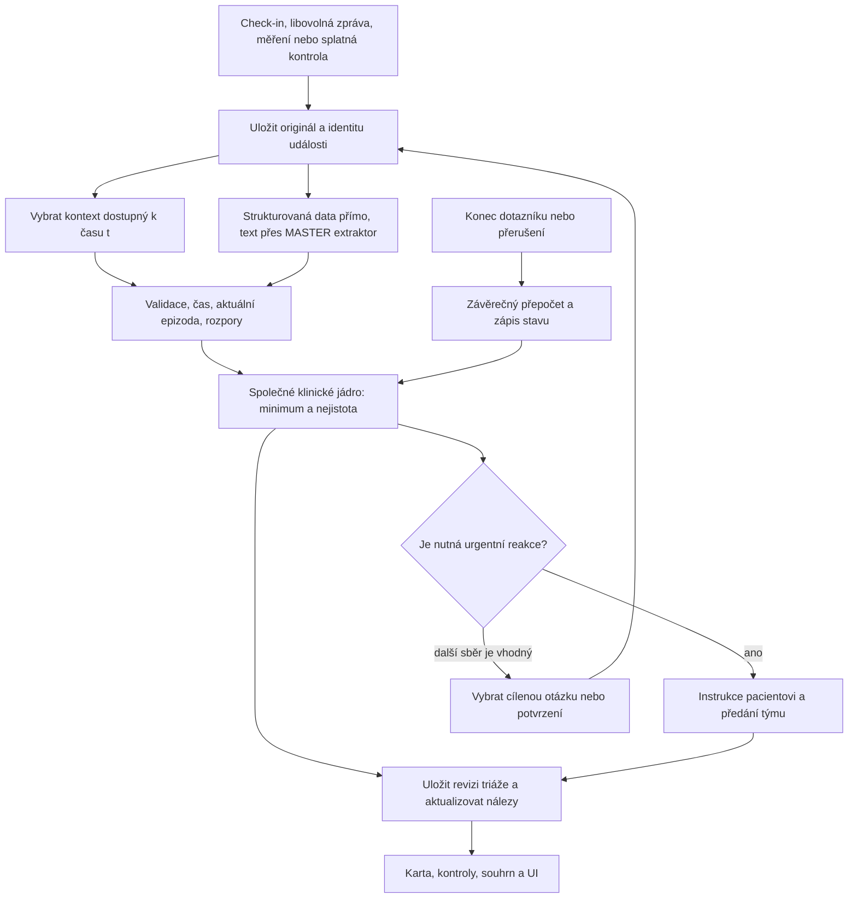

# MEDDI ONCO: požadavky, závislosti a plán pipeline a webu

Revize 17. 10. 2026. Výchozí `main`: `ca8ebd1`; dostupná lokální reference
`origin/web`: `6aeb385`. V této relaci vzniká **pouze plán a seznam kroků**,
jak tým výslovně upřesnil. Aplikace, zdrojová data, závislosti ani větve se nemění.
Před budoucí integrací ověřit aktuální stav vzdálených větví i práci kolegů;
tato revize neprováděla fetch a nevidí jejich nepushnuté změny.

Cíl řešení: pacient doma srozumitelně sdělí obtíže, systém spojí zprávu,
dotazník, měření a dostupný kontext léčby, průběžně zachytí naléhavou situaci,
na konci uloží triáž a další krok a předá zdravotníkovi ověřitelný přehled.
Následným cílem je tuto funkcionalitu začlenit do existujícího webu ve větvi
`web`. Přenos do této větve a ostré klinické nasazení jsou odlišné milníky.

## 1. Podklady a jejich platnost

| ID | Znovu přečtený zdroj | Co z něj přebíráme |
| --- | --- | --- |
| S1 | [MEDDI – MEDDI Onco.pdf](<../documents/MEDDI – MEDDI Onco.pdf>), všech 13 stran; s. 5–12 také vizuálně | Cíle s. 4–5; úrovně s. 6; mantinely s. 7; data s. 8; šest situací s. 9; skrytý časový test s. 10; váhy s. 11; souhrn, zpráva a integrace s. 12 |
| S2 | [MEDDI_Onco_Rakathon_2026.pptx](../documents/MEDDI_Onco_Rakathon_2026.pptx), všech 6 slidů i poznámky | Koordinace péče, odpovědnost za požadavek a srozumitelný kontakt, slidy 2–3 a 5–6; klinická rozhodnutí zůstávají zdravotníkům, poznámky slidu 5 |
| S3 | [README datového balíčku](../rakathon_meddi_onco_data/README.md), §1–6 | Formát, fiktivní data, časové přehrávání, význam barev, výstup na check-in, pravidla a provoz v EU |
| S4 | [pravidla_triaze.md](../rakathon_meddi_onco_data/docs/pravidla_triaze.md), celý dokument §1–6 | Tvrdá minima, typické situace, kontext, pracovní doba, nejistota, předání a pečující |
| S5 | [dotazniky_definice.json](../rakathon_meddi_onco_data/docs/dotazniky_definice.json), všechny 4 dotazníky / 49 otázek | Přesné otázky, možnosti, barvy, upozornění, podmínky a směr škál |
| S6 | [pacientska_cesta_meddi_onco.md](../rakathon_meddi_onco_data/docs/pacientska_cesta_meddi_onco.md), celý dokument | Předání monitorovacímu centru, navrhované API operace, oddělený adaptér a infrastruktura AWS v EU |
| S7 | [vzorove_souhrny_pro_lekare.md](../rakathon_meddi_onco_data/docs/vzorove_souhrny_pro_lekare.md), zásady a všechny 4 ukázky | Jedna úvodní věta, trendy, datované podklady, rozlišení sdělení/měření/odhadu, čtení do 30 s |
| T1 | [AGENTS.md](../AGENTS.md) a komentáře týmu z 17. 10. | Pracovní význam klíčových/varovných nálezů, jejich sledování a požadovaný přenos do webu |
| T2 | Všechny soubory v `docs/`, kořenové README, [README intake](../llm_intake/README.md), [MASTER kontrakt](../llm_intake/MASTER_CONTRACT.md), oba prompty | Historie rozhodnutí, existující rozhraní a známé mezery; starší text nepovažovat za aktuální specifikaci |

Pořadatel určuje klinické minimum a soutěžní povinnosti. Tým určuje
implementaci a pracovní názvosloví. Návrhy nových rozhraní a kroků níže
**nejsou hotový kód ani klinicky schválený protokol**. S4 §3 je tvrdé minimum;
S4 §4–6 obsahuje i úsudkové situace, které potřebují kvalifikované ověření.

V dostupných zdrojích není nečitelný text podstatný pro plán. Poznámky S2
odkazují také na produktový leták a původní e-mail, které nejsou v repozitáři;
tyto podklady nebyly nově ověřeny a nevytváříme z nich další požadavky.
Údaj o úspoře na slidu 4 není měřením našeho řešení. Zadaný termín a formát
odevzdání ani přístup ke skryté sadě v lokálních podkladech nejsou.

## 2. Povinnosti a přijímací podmínky

ID Pxx se používají v implementačních krocích. „Částečně“ znamená existující
modul, jehož schopnost ještě není zapojena do úplného průchodu.

| ID | Požadavek a podmínka dokončení | Zdroj | Dnešní stav / hlavní závislost |
| --- | --- | --- | --- |
| P01 | Pravidelně zjistit symptomy, intenzitu a vývoj, srozumitelně a s omezenou zátěží; nezopakovat již známý údaj | S1 s. 5; S3 §2; T1 | Intake a omezený MASTER existují; chybí politika kontrol |
| P02 | Použít léčbu, léky včetně podpůrných a chronických, komorbidity, výchozí stav, laboratoř, vyšetření a zásahy týmu podle dostupnosti | S1 s. 5, 8; S3 §5; S4 §5–6 | Částečný `patient_inputs`; chybí úplná časová karta |
| P03 | Vstupem jsou dotazníky, `zprava_pacienta`, měření a přílohy; všechny zůstávají dohledatelné | S1 s. 8; S3 §5; S6 | Vstupy se uchovávají odděleně, webový export je ztrátový |
| P04 | Zpracovat češtinu, slovenštinu, překlepy a text bez diakritiky; zachovat doslovný zdroj | S1 s. 8; S3 §5 | Extraktor existuje; úplná datová cesta chybí |
| P05 | Zprávu vyhodnotit i bez zmínky v dotazníku; při rozporu se doptat a do té doby použít horší doloženou možnost | S1 s. 12; S3 §6.5; S4 §6.2–4 | Částečný adaptér konfliktů; nejisté alternativy chybí |
| P06 | Jediný deterministický výpočet úrovně 1–4; nejvyšší aktivované tvrdé minimum, nikdy pod §3 | S4 úvod a §3; T1 | Jádro `meddi/` existuje; úplnost vstupů a klinické review zbývají |
| P07 | Známé červené minimum vyvolá okamžitou instrukci a předání; nečeká na dokončení dotazníku ani potvrzení | S1 s. 6–7; S4 §1–3; T1 | `evaluate_contact` umí minimum před potvrzením; orchestrace/UI chybí |
| P08 | Po dokončení dotazníku/kontaktu znovu vyhodnotit a uložit finální revizi i s podklady; rozpracovaný stav uchovat samostatně | S3 §4; T1 | Výpočet existuje, trvalé uložení celého výsledku chybí |
| P09 | Nezelené odpovědi i klinicky nezelené nálezy patří do klíčových a mají otevřené sledování; zachytit i zlepšení a kontext | T1; S4 §4–6; S7 | `non_green_answers` existuje; registr nálezů a kontroly chybí |
| P10 | Aktuální varovné nálezy vedoucí k 3/4 jsou podmnožinou klíčových; u 1/2 je seznam varovných prázdný | T1; S3 §5; S4 §1, 3–4 | Nutný strukturovaný výstup s vazbami na pravidla |
| P11 | Doporučení pacientovi vychází z nálezů, úrovně a pravidel, také u 1/2; obsahuje důvod, konkrétní krok a kontakt | S1 s. 6–7, 12; S3 §4–6; T1 | Chybí deterministická politika odpovědi a kontaktů |
| P12 | Úrovně 2–4 předat zdravotníkovi, se správnou prioritou, lhůtou a dohledatelným stavem upozornění | S1 s. 7; S4 §1–2; S6 | Chybí předávací adaptér a evidence doručení |
| P13 | Kontakty a lhůty řídit časem Europe/Prague a pracovní dobou; červená vždy ihned | S1 s. 6–7; S4 §2 | Chybí časová politika a potvrzení kalendáře |
| P14 | Žádná diagnóza pacientovi, změna léků ani dávky; připomenout pouze konkrétní předem doložený lékařský postup | S3 §6.1; S4 §6.5 | Omezit šablony výstupů, dohledat plán a jeho platnost |
| P15 | Nejasnost, neodpověď, chyba modelu a chybějící údaj nejsou negativní nález; zachovat minimum a cestu k lidskému posouzení | S3 §6.2; S4 §4, §6.4 | Stavy existují částečně; dnešní přeskakování není plné §6.4 |
| P16 | Hodnotit aktuální epizodu i trend; zlepšení po zásahu týmu zaznamenat, nový/zhoršený příznak posoudit znovu | S4 §5, §6.1 a §6.3 | Číselné trendy částečně; správa epizod a intervencí chybí |
| P17 | Při zastupování oslovit pečujícího, oddělit jeho obtíže od pacientových a hodnotit zátěž | S3 §5; S4 §4 a §6.7 | Extrakce rozlišuje subjekt; web vždy ukládá pacienta |
| P18 | Paliativní přání předat týmu, nikdy jimi nevyloučit pomoc; mít prioritu paliativního kontaktu a náhradní cestu | S4 §5 | Chybí kontaktní politika a dostupnost konkrétního týmu |
| P19 | Souhrn pro lékaře do 30 s: aktuální důvod, očekávaný krok, kontext, trendy, citované události a nejistoty | S1 s. 12; S7 | Chybí producent souhrnu nad kartou |
| P20 | Pro každý check-in strukturovaný výstup a párování přes `patient_id`/`checkin_id`; žádný odhad „vyplněno“ u neúplného kontaktu | S3 §4–5 | Backendový formát existuje; finální export chybí |
| P21 | V replay zpřístupnit jen informace známé do t; reference, názvy scénářů a budoucí souhrny mimo rozhodování i LLM | S1 s. 10; S3 §4–5 | Částečně hlídá adaptér; celková časová hranice chybí |
| P22 | Ověřit všech šest povinných situací včetně protikladných/negativních případů | S1 s. 9–10 | Dílčí testy, úplný průchod zbývá |
| P23 | Oddělit datový adaptér od logiky, navrhnout MEDDI integraci bez dostupného API | S1 s. 12; S3 §2; S6 | Část loaderů existuje; předávací rozhraní chybí |
| P24 | Pro ostrý provoz navrhnout AWS v EU, data v EU bez ukládání u třetích stran; do LLM jen nezbytná data | S1 s. 7; S3 §6.9; S6 Provoz | Současná hackathonová brána není důkaz splnění ostrého provozu |
| P25 | Měřit záchyt orange/red, podhodnocení red a zbytečné eskalace; zvlášť správné kontakty a lidsky posouzenou srozumitelnost | S1 s. 10–11; S3 §4 | Strukturovaný baseline existuje; úplná pipeline zbývá |
| P26 | Zachovat existující webové prvky, napojit je na skutečné API a stejná pravidla jako CLI | T1 | Webový snapshot má nekompatibilní API, viz §8 |
| P27 | Evidovat poslední skutečnou chemoterapii, odstup, typ léčby, cyklus, rizikové okno a zdroj; neodvozovat chemoterapii jen z cyklu | T1; S3 §5; S4 §3 a §5 | Částečný příznak ≤42 dní; detail a úplnost podání chybí |

Soutěžní váhy: bezpečnost a klinický přínos 30 %, využitelnost 25 %, AI a
technologie 20 %, UI 15 %, integrace 10 % (S1 s. 11). Hlas je bonus (S1 s. 12),
ne závislost dokončení základního toku. Šest skrytých pacientů není dostupných;
neslibujeme nad nimi výsledek. Přesný formát odevzdání potvrdit s pořadatelem.

## 3. Zpracování komentářů týmu

**Klíčové nálezy a sledování.** Každá yellow/orange/red odpověď se zachovanou
barvou zdroje vstoupí do klíčových nálezů. Přidat také nezelený výsledek pravidla,
rizikové měření, relevantní zprávu, adherenci, změnu stavu a důležitý léčebný
kontext; výběr nesmí záviset jen na barvě formuláře. Například neuropatie může
mít zelenou odpověď, ale význam před další aplikací, a suicidalita nemá barvu
vůbec (S5 `brneni`, `psychoonkologicky_screening/sebevrazda`; S4 §3–4).

Ke každé otevřené potíži vést epizodu a cílenou kontrolu. Sledování znamená
evidovaný cíl a další krok; ne automaticky novou otázku po každé události.
Pokud aktuální zpráva potřebný údaj už doplnila, kontrolu splnit bez opakování.
Klinický interval není dodán pro každou potíž; použít až schválenou politiku,
jinak označit potřebu naplánování týmem. Nepřidávat univerzální „zítra“.

**Varovné příznaky.** Aktuální nález nebo kombinace s kontextem, která aktivuje
pravidlo 3/4, je klíčový nález s příslušným příznakem varování. Uvést také
aktivovaná oranžová pravidla při celkové červené. Žluté nálezy jsou důležité,
ale podle pracovního výkladu týmu nejsou varovné. Pro výstup 1/2 je
`varovne_priznaky=[]`. Odeznění dřívějšího varování zůstane klíčovým nálezem
se změnou „zlepšeno/odeznělo“ a historickým odkazem, nikoli aktivním varováním.
Nejistou rizikovou alternativu označit jako nejistou; nevydávat ji za potvrzený
příznak. V kontrolovaných referencích nemá žádný záznam úrovně 1/2 neprázdné
`varovne_priznaky`; to podporuje pracovní výklad, nenahrazuje klinické review.

**Kritický nález ihned.** Prokázané red minimum má přednost před další otázkou,
potvrzením, souhrnem i běžným exportem. Zobrazit konkrétní instrukci neodkladné
pomoci a spustit evidované upozornění týmu. Orange spustí příslušnou naléhavou
kontaktní cestu; není automaticky totéž co red. Snížení prozatímní úrovně při
pozdějším vyjasnění musí být nové zdůvodněné vyhodnocení, ne smazání události.

**Závěr dotazníku.** Dokončení sběru vždy vyvolá novou revizi triáže a trvalý
zápis s časem, vstupy, verzí pravidel a doporučením. Při `limited`, `unresolved`,
`cancelled` nebo `processing_error` také uložit dosavadní stav a známé minimum,
ale neoznačit jej za úplné vyhodnocení. Dokončení rozhovoru a dokončení
klinického posouzení jsou různé atributy.

**Doporučení pacientovi.** Kód vybírá krok, kontakt, naléhavost a schválený text
podle klíčových nálezů, výsledné úrovně, léčebného plánu a pravidel. Má podklad
i u green/yellow. Neodvozovat je pouze z `varovne_priznaky` a nespojovat bez
kontextu všechna upozornění původních možností. Případné jazykové přeformulování
nesmí měnit význam, kontakt, lhůtu ani přidávat léčebný pokyn.

**Poslední chemoterapie.** V kartě oddělit typ léčby a skutečné podání od
plánovaného termínu. Počítat odstup od posledního známého podání do t, probíhající
léčbu a okno do 6 týdnů po ní; D7–14 je zvláštní kontext, nikoli jediná doba,
kdy platí horečkové pravidlo (S4 §3 a §5). U režimu s více dávkami nestačí
automaticky poslední D1. Cyklus imunoterapie ani cílené léčby nedokládá
chemoterapii. Neúplné údaje ponechat `unknown`, ne `false`; datum bez času
nesmí vytvářet přesný okamžik podání. Výklad dostupnosti D1 a hranice 42 dní
podle data/času potvrdit pro produkční adaptér.

**`zprava_pacienta`.** Každou neprázdnou zprávu převést na `MessageEvent` se
`source=patient_message`, správným pacientem, autorem a časem check-inu.
Otázka je null, pokud původní otázku neznáme. Zachovat originál a extrakci;
nic nepřekládat na odpověď na právě vymyšlenou otázku. Stejně zpracovat
spontánní zprávu i novou potíž během cílené otázky. Prázdná zpráva není
popření příznaků. Negace, počty nad normál, časové okno a subjekt musí zůstat
rozlišeny. Příloha je samostatný podklad se svým původem; textový popis není
automaticky obrazová diagnóza. Nevyhodnotitelná příloha zůstane k posouzení.

## 4. Úplný klinický rozsah, který musí vstupní cesta obsloužit

Následuje kontrolní inventář S4, nikoli nový protokol. Každý řádek potřebuje
vstup, zdroj, čas, pravidlo a kontrolní scénář. Samotná existence pravidla
v kódu nedokládá, že jeho vstupy umí získat LLM, karta nebo web.

### Tvrdá červená minima — S4 §3 / Červená

| Oblast | Podmínky ze zadání / potřebné rozlišení |
| --- | --- |
| Horečka | ≥38 °C **nebo zimnice** během chemoterapie či do 6 týdnů po ní; doložit typ a čas léčby |
| Dýchání | Klidová dušnost; SpO2 <90 %; náhlá dušnost s bolestí na hrudi nebo palpitacemi |
| Hrudník | Nová bolest na hrudi; dlouhodobá léčená bolest není automaticky nová |
| Neurologie | Zmatenost, porucha vědomí/probuditelnosti, záchvat, nová slabost končetin, porucha řeči |
| Krvácení | Krev ve stolici/zvratcích/moči, černá stolice, nos >20 minut, úraz hlavy na antikoagulaci |
| Průjem | ≥7 stolic **nad normál za 24 h** nebo průjem s krví; celkový počet není počet nad normál |
| Zvracení | >5 epizod za 24 h nebo neudržení tekutin **se známkami dehydratace** |
| Oběh | Nemočení >10 h, mdloba nebo systolický TK <90 mmHg |
| Břicho | Zástava plynů i stolice se zvracením nebo kolikovitou bolestí |
| Tlak | TK ≥180/110 nebo vysoký tlak se silnou bolestí hlavy, poruchou zraku/řeči či bolestí na hrudi; výklad párového prahu ověřit |
| Metabolismus | Zvracení + bolest břicha + zrychlené dýchání při diabetu nebo imunoterapii |
| Opioidy | Nová nápadná spavost, nereagování nebo zpomalené dýchání; pro jádro doložit opioidový kontext |
| Psychika | Sebevražedné myšlenky s plánem, úmyslem nebo prostředky |

### Tvrdá oranžová minima — S4 §3 / Oranžová

| Oblast | Podmínky ze zadání / potřebné rozlišení |
| --- | --- |
| Celkový stav | Pocit 5 = velmi špatně |
| Dýchání | SpO2 <92 % nebo pokles ≥3 procentní body proti obvyklému stavu; nová ortopnoe |
| Průjem | 4–6 nad normál při imunoterapii, fluoropyrimidinech nebo irinotekanu; neúčinný loperamid podle schématu; jakýkoli průjem s bolestí břicha při imunoterapii |
| Příjem | Neudrží tekutiny; nově jen tekutá strava a nekontrolovaná bolest; snížený příjem a málo močí nebo ortostatické závratě |
| Zvracení | 3–5/24 h a současně neudrží tekutiny |
| Tlak | ≥160/100 při antiangiogenní léčbě |
| Krvácení | Jakékoli krvácení nebo nové modřiny na antikoagulaci |
| Žíly | Jednostranný otok a bolest lýtka; součástí doporučení musí být poučení o příznacích plicní embolie podle schváleného textu |
| Bolest | NRS ≥7 přetrvávající po SOS dávce; počet SOS dávek neprokazuje neúčinnost |
| Mozkový nádor | Ranní bolest hlavy se zvracením |
| Imunoterapie | Velká žízeň + časté močení + hubnutí |
| Glykémie | <4 mmol/l při inzulinu |
| Psychika | Kladná odpověď na suicidální otázku nebo výroky beznaděje; nepřítomnost plánu nesnižuje doloženou oranžovou |
| Opakovaná eskalace | Zhoršení přes již naplánované vyšetření; nečekat na termín |

### Typické žluté situace — S4 §4

| Oblast | Požadovaný vstup a kontext |
| --- | --- |
| Příznak 2. stupně | Bez varovných příznaků; nevolnost s omezením jídla, zácpa ≥3 dny, afty omezující jídlo, paronychie, ruka-noha s omezením činností |
| Průjem a zvracení | Do 3 stolic nad normál na imunoterapii, jinak typicky green; 3–5 zvracení při zachovaném pití |
| Tlak a glykémie | ≥3 měření TK ≥140/90; hypotenze s ortostatickou závratí; glykémie >15 + žízeň + časté močení, kontakt týž den |
| Neuropatie a sluch | Přetrvávání mezi cykly nebo omezení jemné motoriky **před další aplikací**; nový tinnitus na cisplatině **před další dávkou** |
| Váha, otoky, funkce | Otoky 2. stupně nebo >2 kg/3 dny při kardiotoxické léčbě; úbytek ≥5 %/měsíc, soběstačnost horší o 2 stupně, postupný pokles příjmu |
| Bolest | NRS 4–6 nebo ≥3 SOS dávky denně |
| Psychika a adherence | Střední smutek/úzkost, vyčerpání pečujícího, vynechávání léků |
| Neodpovědi | Stabilní pacient: 1–2 vynechané check-iny připomenout, 3 za sebou yellow; pravidlo nelze bez potvrzení zobecnit na rizikový stav |

### Kontext a obecná pravidla — S4 §5–6

Zahrnout nadir D7–14; možnost rychlé toxicity kdykoli na imunoterapii a hlášení
nového průjmu, kašle, dušnosti, žízně či únavy týmu; rizikovou léčbu průjmu
fluoropyrimidiny/irinotekanem; u irinotekanu interval 12 h bez průjmu podle
doloženého schématu (do té doby nejméně yellow). Dále antikoagulaci a interakce,
antiangiogenní rizika, pauzy cyklické léčby a antihypertenziva, obvyklý stav
při CHOPN/diabetu/srdečním či renálním onemocnění, sociální situaci, věk,
digitální gramotnost, paliativní plán a dříve vyslovená přání. Neodvozovat
nové dávkování ani diagnózu z této tabulky.

Trend se hodnotí nad časovou řadou, ne jen jednou odpovědí. Sledovat zásah
týmu a skutečné zlepšení; nové či horší obtíže znovu posoudit. Samotné převzetí
upozornění týmem nesnižuje závažnost. Nejasnost vyžaduje relevantní doptání
a do odpovědi vyšší podloženou variantu, ne všechny myslitelné katastrofy.
Konkrétní algoritmy neurčené zadáním musí potvrdit mentor.

## 5. Kontaktní a výstupní politika

Přepis S4 §1–2, doplněný o týmový požadavek průběžného upozornění:

| Úroveň | Krok | Pracovní doba | Mimo pracovní dobu | Tým |
| --- | --- | --- | --- | --- |
| 1 | `dalsi_sledovani` | Sledování a instrukce, kdy se ozvat dřív | Totéž | Záznam v přehledu, bez aktivního alertu |
| 2 | `kontaktovat_tym` | Centrum; vyřízení do konce následujícího pracovního dne | Centrum následující pracovní den + instrukce pro dřívější zhoršení | Ano |
| 3 | `telekonzultace` | Lékař MOÚ, kontakt do 2 h | Sloužící lékař MOÚ ihned | Ano, vysoká priorita |
| 4 | `neodkladna_pomoc` | Ihned 155 / urgentní příjem | Ihned 155 / urgentní příjem; S4 uvádí případně sloužícího lékaře | Ano okamžitě; podle §2 upozorněn do 15 minut |

Centrum: pracovní dny 7:00–15:30. Sloužící kontakt ve zdroji:
724 590 848. Tyto údaje jsou přepis soutěžních podkladů, kontaktní konfiguraci
pro skutečný provoz potvrdí pracoviště. Paliativní plán může určovat 24h tým /
hospic; při nedostupnosti uvádí S4 §5 číslo 155. Nesmí tím zaniknout potřeba
pomoci ani se čekat na chat. Žluté pravidlo glykémie „ještě týž den“ a předání
neuropatie/tinnitu „před další dávkou“ se zachovají jako zvláštní časové podmínky,
nepřepíší se obecnou lhůtou yellow. Jejich kolizi s pracovní dobou upřesnit.

Finální soutěžní export musí obsahovat `patient_id`, `checkin_id`, `uroven`,
`doporuceny_krok`, `upozornit_tym`, `doporuceny_kontakt`, `klicove_nalezy`,
`varovne_priznaky`, `zduvodneni`, `doporuceni_pro_pacienta` a podle potřeby
souhrn (S3 §4–5). Česká pole jsou výstupní adaptér; interní anglické rozhraní
`meddi_contact_assessment/v1` se kvůli tomu nepřejmenovává.

Neúplný kontakt má vlastní technický export a explicitní stav. `color=null`
se nesmí serializovat jako `uroven=1`; dokud není podložené rozhodnutí nebo
lidské posouzení, nelze tvrdit splnění úplného kontraktu 1–4. Předchozí známé
riziko se uchová. Upozornění rozlišuje požadováno / čeká na doručení / doručeno /
převzato / uzavřeno / chyba; „upozornit tým“ není důkaz skutečného kontaktu.

## 6. Cílový tok a datové závislosti



Orchestrátor musí dostat obecnou extrakci a spustit bezpečnostní vyhodnocení
**před dalším cíleným LLM voláním**, ne jen po návratu `start()`/`submit()`.
Dnešní `MasterDialogue` uvnitř těchto metod pokračuje k cílené extrakci;
její zdržení nebo chyba nesmí odložit již rozpoznaný kritický nález. Původní
událost uložit před voláním modelu; při chybě cíleného přiřazení nesmí zmizet
úspěšná obecná extrakce. Strukturované tvrdé pravidlo má fungovat i při výpadku
LLM. Bez extrakce textu se nedá slíbit záchyt libovolného kritického sdělení;
takový kontakt zůstane chybou k předání člověku, ne zeleným úspěchem.

### Navržené záznamy pro kartu a úložiště

Názvy níže jsou návrh pro další krok; dnes nejde o nově zavedené API.

| Záznam | Minimální obsah a vazby |
| --- | --- |
| Událost | `event_id`, stabilní `patient_id`, `checkin_id/contact_id`, typ, autor, původní text/data, skutečná otázka, `available_at`, případný skutečný čas a odkaz na opravu |
| Pozorování | Pojem, hodnota/interval, jednotka, časové okno, subjekt, přítomnost/popření/nejistota, citace, `source_event_id`, stav potvrzení |
| Léčebný kontext | Typ léčby, platnost léků, skutečná a plánovaná podání odděleně, poslední chemo a odstup, cyklus, zdroje a chybějící informace |
| Nález / epizoda | `finding_id`, parametr, první/poslední pozorování, aktuální stav a vývoj, zdrojová barva odpovědi zvlášť od klinické úrovně, `warning_rule_ids`, odkazy na důkazy, otevřenost/odeznění a historie |
| Revize triáže | `assessment_id`, kontakt/check-in, čas t, revize vstupů a pravidel, původní celý intake, `triage_inputs`, minimum/barva/stav úplnosti, důvody a zdroje, nevyřešené vstupy, výstupní krok |
| Kontrola | `followup_id`, vazba na nález/epizodu, co ověřit a proč, cílová otázka nebo chybějící rozlišení, `due_at` či stav „čas určí tým“, verze politiky, stav a splňující událost |
| Předání | Úroveň/typ kontaktu, příjemce, zdrojová revize, lhůta, stav odeslání/převzetí a pokusy, klíč proti duplicitám |
| Snapshot karty | Odvozený pohled k `as_of`; aktuální relevantní pozorování, léčba a otevřené epizody/kontroly, vždy rekonstruovatelný z historie |

`varovne_priznaky` odkazují na stejné identifikované nálezy jako
`klicove_nalezy`, aby byl vztah podmnožiny ověřitelný; výstupní texty lze
vygenerovat z těchto vazeb. Nekopírovat dva nezávislé seznamy vytvořené LLM.
Oprava ani zlepšení nesmažou původní důkaz a předchozí upozornění.

Pro prototyp navrhujeme SQLite ze standardní knihovny za malým úložným
rozhraním; konkrétní schéma patří do kroku K2. Produkční databáze závisí na
prostředí MEDDI. Uložit událost, revizi a požadavek k předání s opakovatelným
klíčem; po pádu pokračovat bez ztráty a duplicit. Browser session není pacient.
Úplný snapshot dnešního dialogu není automaticky serializované resume;
obnovu relace je nutné samostatně navrhnout, nikoli znovu spustit LLM nad
celým kontaktem a předstírat shodný stav.

### Časová hranice a dostupnost

Použít explicitní hodiny, uložené časy s pásmem a zobrazení/routing v
`Europe/Prague`. Historická `datum/cas` nemají pásmo: převod patří do adaptéru
s uchovanou původní hodnotou a deklarovanou politikou. Jen datum není přesný
okamžik; dostupnost výsledku laboratoře není automaticky čas odběru.
Časově filtrovat i léky, podání, vyšetření, volné poznámky a zásahy týmu.
Budoucí změna vložená do dnešního souhrnného pole se nesmí dostat do kontextu.

Neznámý příznak, explicitní popření, nevyplnění a rozpor jsou různé stavy.
Aktuální hodnoty nemají být maximum celé historie. Zlepšení a vyřešená
epizoda nesmějí navždy nést starou červenou; současný rozpor nesmí přepsat
rizikovou informaci mírnější volbou. Platnost a klinickou expiraci nelze
univerzálně odvodit ze stáří záznamu. Pravidla dostupnosti neurčená zdrojem
zapsat jako nejistotu a konzultovat, ne doplnit skrytou domněnkou.

## 7. Co skutečně existuje a co chybí

Ověřeno čtením kódu na uvedených commitech a offline kontrolami:

| Komponenta | Zachovat / využít | Chybějící práce |
| --- | --- | --- |
| `llm_intake/master.py`, `master_contract.py`, katalog a schéma | Obecná extrakce, původ, subjekt, negace, intervaly, všech 49 témat | Sjednotit klinicky přesné pojmy s adaptérem; obecný koncept neprokazuje všechny podmínky pravidla |
| `llm_intake/core.py`, `flow.py`, `dialogue.py` | Větvení ze zdroje, doptání, potvrzení/odmítnutí, limit 6/2, nevyřešené stavy | Bezpečnostní bod před cílenou extrakcí, řízení priorit, plánované kontroly, persistované obnovení |
| `meddi/form.py` | Přímé strukturované odpovědi, metadata a `non_green_answers` | Napojit na registr nálezů; barva možnosti není finální úroveň |
| `meddi/triage.py`, `clinical_rules.py`, `validation.py` | Jediné jádro širších pravidel a ověřování jednotek/domén | Klinické ověření, vyřešení nejasných definic a relevantních alternativ |
| `meddi/pipeline.py` | `evaluate_contact`, zdroje, celý intake, minimum/úplnost, časový výběr a konflikty | Obecné intervaly a relativní čas, úplné zapojení zdrojů, finální kroky/kontakty a karta |
| `meddi/patient_inputs.py` | Časově omezená historie, omezené rozpoznávání léčiv a konkrétní číselné trendy | Poslední skutečné podání a úplnost léčby; laboratoř, vyšetření, intervence, epizody a text |
| `main.py` | Oddělené referenční porovnání po check-inech | Replay celé pipeline včetně zpráv, karty, routingů a souhrnů |
| `origin/web:web/` | Flask, šablona, styly, slovní vstup, nabídka možností, kontrola/opravování a JS odesílání | Kompatibilita API, identita, úplné uložení, bezpečnostní/závěrečný výstup a pohled zdravotníka |

Čerstvé ověření 17. 10.: **543 testů prošlo**, Ruff prošel. Strukturovaná cesta
`main.py`: **132/171 shod, 30 nižších, 9 vyšších, 171 k review**. Z referenčních
6 červených zůstávají 2 podhodnocené (`ONC-011-C09`, `ONC-014-C09`). To není
přesnost úplné pipeline a není to klinické schválení. Dřívější LLM měření jsou
v `tasks.md`; v této revizi se model znovu nevolal.

Lokální audit zdrojů potvrdil 14 pacientů, 171 check-inů, z toho 96 s neprázdnou
zprávou a 3 nevyplněné, 4 dotazníky a 49 otázek. Reference mají 115/37/13/6
úrovní 1/2/3/4. Referenční pole byla čtena odděleně pouze pro audit a porovnání.

## 8. Začlenění do existující větve web

Kontrola je statická nad `origin/web=6aeb385`; Flask server této větve nebyl
spuštěn. Následující závady nejsou opravené tímto plánem:

| Místo | Zjištění | Plán integrace |
| --- | --- | --- |
| `web/app.py` | Importuje `MasterDialogue`, ale jeho modul ve větvi chybí; používá neexistující `bulk_confirmation`, `review_sessions`, `confirm_all()`, `revise()` | Při integraci přinést aktuální backend a napojit UI na skutečné API; pro první krok využít `confirm()/reject()/submit()`. Souhrnné potvrzování až jako samostatně navržená změna, pokud je tým vyžádá |
| `web/app.py:message/state` | `patient_id` je náhodná webová session; po restartu se mění | Oddělit identitu pacienta, kontaktu a session; zachovat jednoho pacienta napříč kontakty |
| `web/app.py:page_for` | Varování z možností formuláře zastupují kontextový výsledek | Zobrazovat odvozené rozhodnutí stejné backendové pipeline; varování možnosti mít se zdrojem odděleně |
| `web/export.py` | Vynechá fakta, citace, stav dialogu, čekající témata i měření; sloučí zprávy a vždy nastaví `vyplneno` a autora pacient | Primárně uložit celý kontakt a revize; MEDDI JSON vyrábět jako odvozený export, zachovat autora i neúplnost |
| `web/templates/index.html` | Existují vstup, čekání, chyby, review, opravy a potvrzení; hotovo říká jen „uloženo“ | Zachovat vzhled a ovládání; doplnit průběžné urgentní sdělení a závěrečný krok/kontakt, později kartu a pohled týmu |
| `web/static/form.js` | Zamezuje dvojímu kliknutí jen v browseru | Zachovat UX a přidat serverovou idempotenci; opakované POST/refresh nesmějí zdvojit kontakt či alert |
| Provoz | Stav relací v globálním dict, náhodný secret po startu, vývojové `app.run()` | Pro demo výslovné omezení; před skutečným provozem úložiště, obnova a řízení souběhu, autentizace/oprávnění, CSRF, stálý secret a produkční server |

První webový krok má zachovat formulář, šablony a styly. Nepřepisovat frontend
do jiného frameworku a nekopírovat klinická pravidla do Jinja/JS. Web volá
aplikační službu, která používá stejný vstup a jádro jako CLI. Chyby modelu
a souborů se pacientovi zobrazují srozumitelně bez úniku interních detailů;
uložený zdroj a známé riziko zůstávají zachované.

Závislosti: main nemá runtime knihovny; web má Flask a python-dotenv.
Při přenosu zachovat potřebné existující webové závislosti a společně
zkontrolovat `pyproject.toml` i `uv.lock` pomocí uv. SQLite je návrh bez nové
knihovny. RAG, nový frontend, trénování modelu a hlas nejsou podmínkou integrace.
Bez pokynu se nic necommituje, nepushuje ani nenasazuje.

## 9. Pořadí malých implementačních kroků

K0 je výsledkem této relace. Ostatní kroky mají začít postupně po domluvě;
„soubor“ u dosud neexistujícího modulu znamená navrhované umístění.

| Krok | Závisí na | Rozsah a využití existující práce | Hotovo, když |
| --- | --- | --- | --- |
| K0 · zdrojovaný plán | Podklady S1–S7 a T1 | Tento dokument, challenge/architecture/decisions/tasks, orientační odkazy | Cíle, požadavky, komentáře, rozpory, závislosti a kontrolní scénáře jsou dohledatelné; bez změny aplikace |
| K1 · kompatibilní webový základ | K0; aktuální Git stav a domluvené převzetí main do web | Existující `web/app.py`, šablona, styly, JS; `llm_intake` ponechat; manifest + lock | Web otevře MASTER, přijme text, zobrazí doptání/potvrzení, umožní odmítnout a opravit; falešný LLM prokáže funkčnost bez neexistujících metod. Stav není vydáván za triáž |
| K2 · události, identita a úplné uložení | K0; sjednocený datový kontrakt, pro UI K1 | Navržené `meddi/store.py`, `meddi/card.py`; `web/export.py`, `web/app.py` | Stabilní pacient, originální zpráva uložena před LLM, celý paket a revize po načtení neztrácejí data; neúplný stav není vyplněný; druhý POST není druhá událost. Vymezena podpora obnovení relace |
| K3 · časový kontext a chemoterapie | K2; domluva dostupnosti dat | `meddi/patient_inputs.py`, karta/adaptér; využít existující registry léčiv a trendy | Doložená poslední aplikace, odstup a příznaky léčby se zdrojem; budoucí dávka, imunoterapeutický cyklus či neznámý lék nevytvoří falešnou chemoterapii; jasná politika date-only dat |
| K4 · průběžná a závěrečná orchestrace | K2, K3; skutečné `evaluate_contact`; pro UI K1 | Navržené `meddi/orchestrator.py`, bezpečnostní bod v `llm_intake/dialogue.py`, `web/app.py` | Obecná extrakce → vyhodnocení → teprve další cílené volání; red přeruší běžný sběr. Závěr a každé přerušení uloží novou revizi. Chyba cíleného LLM nezahodí již zjištěná fakta |
| K5 · nálezy a cílené sledování | K2–K4; potvrzená politika termínů | Karta, navržené `meddi/followup.py`; využít `non_green_answers`, `QuestionnaireFlow` a cílené Intake | Všechny nezelené nálezy jsou klíčové a mají sledování; zlepšení zůstane viditelné, aktivní varování tvoří podmnožinu; aktuální odpověď splní duplicitní kontrolu, limit nechá zbytek otevřený |
| K6 · kroky, kontakty a souhrn | K3–K5; kontaktní/časová a textová politika | Navržené `meddi/actions.py`, `meddi/summary.py`, předávací adaptér; šablona webu a export | Každá úroveň má zdůvodněný krok a kontakt; 2–4 vytvoří evidované předání; výpadek doručení se přizná; souhrn doloží aktuální nálezy/trendy bez diagnózy a nových léčebných pokynů |
| K7 · pokrytí textu, nejistoty a klinických mezer | Inventář §4; K3–K6; odpovědi mentora | Registry `meddi/pipeline.py`, normalizace, klinická mapování a doptání, případně kontrakt faktů | Neznámé koncepty ani intervaly nemizí; podložená riziková alternativa nesníží minimum, z přesné hodnoty 7 nevznikne mírnější průjem; řeší se popsané mezery bez hardcodování referencí |
| K8 · karta a pohled týmu ve webu | K1–K7 | Existující Flask/Jinja/CSS rozšířit o přehled nálezů, časovou osu, kontroly a prioritu požadavků | Pacient rozumí dalšímu kroku; zdravotník do 30 s zjistí proč, co se změnilo a co má udělat, může dohledat zdroj a zaznamenat zásah; oprávnění oddělí přístupy |
| K9 · úplný replay a demo | K4–K8 | Rozšířit hodnoticí cestu `main.py` nebo samostatný replay adaptér, existující fixtures a testy | Chronologicky všech 171 check-inů bez budoucích dat a referencí; všech šest situací, měření záchytu i falešných eskalací, srozumitelnost s člověkem, záložní demo bez API; vysvětlené zbývající neshody |
| K10 · provozní připravenost a návrh MEDDI/AWS | K9; potvrzené prostředí, kontakty a klinické/provozní převzetí | Datový/předávací adaptér, konfigurace a dokumentace; nasazení je samostatný krok | Popsaná potřebná volání, správa identit, data a LLM v EU, tajemství, audit, záloha/obnova, timeouty a opakování, doručení alertů a odpovědný tým; žádné tvrzení o produkční připravenosti jen z existence větve |

K7 může přinést požadavek na změnu schématu z K2 nebo nové rozlišení pro K5;
provést jej jako malou navazující migraci, ne přepis celé pipeline. K1 je
technická oprava webu; první úplný svislý průchod vznikne až propojením K2–K6.
Kroky nejsou pokynem zakládat nové větve, worktrees nebo další agenty.

Při implementaci propojit přijímací podmínky: K2 → P03/P08/P20/P21;
K3 → P02/P27; K4 → P05–P08/P15; K5 → P01/P09/P10/P16/P17;
K6 → P11–P14/P18/P19/P23; K7 → P04–P06/P15/P16;
K8 → P17/P19/P26; K9 → P21/P22/P25; K10 → P12/P23/P24.

## 10. Otevřené závislosti a rozhodnutí

| ID | Co je nejasné / rozpor | Co můžeme dělat nyní | Co před dokončením potvrdit |
| --- | --- | --- | --- |
| O1 | NRS text 0–10, typ a poznámka formuláře 1–10 (S5 `nrs`) | Zachovat výslovnou nulu v extrakci a backendu, nepřevést na 1 | Rozsah cíleného potvrzování a lokální adaptace bez změny originálu |
| O2 | Průjem: ≥7 tvrdé minimum vs. možnost >7; první možnost říká 3, ne obecně ≤3 (S4 §3–4; S5 `prujem`) | Zachovat přesný počet a baseline samostatně; při doložených ≥7 dodržet tvrdé minimum | Jak potvrzovat mezery nabídky a neúplné počty/okna |
| O3 | Chybí převod psychoškál/ESAS a obecného omezení ADL na klinický stupeň | Ukázat původní skóre/odpověď; neodvozovat svévolný práh | Klíč screeningu a kvalifikované mapování, včetně neuropatie/kloubů/kožních obtíží |
| O4 | Dnešní přeskakování neznámých podmínek nesplňuje plně vyšší možnou úroveň S4 §6.4 | Oddělit minimum, neúplnost a potřebné otázky; nezobrazit neúplné green jako hotové | Relevantní alternativy a intervaly, lidská cesta při nedořešení |
| O5 | Obecný trend, hypotenze vůči baseline a zlepšení po zásahu nemají úplný algoritmus | Ukládat řady a zásahy se zdroji; tvrdé minimum nesnižovat | Kdy kontext mění typickou §4 situaci, jak epizodu uzavřít a co má ověřit člověk |
| O6 | Tlak 180/110 a 160/100: zdroj neříká explicitně AND/OR; neurčuje číselné „vysoký tlak + příznaky“ | Přiznat dnešní výklad OR a explicitní příznak `high_blood_pressure` | Výklad prahů a obvyklého stavu; nevnášet další vlastní limit |
| O7 | Dostupnost laboratoří, dat bez času, skutečnost podání D1, vícedávkové/orální režimy | Časová hranice s neznámými údaji; žádný budoucí souhrn | Producent kontextu, poslední skutečné podání a platnost léků v čase |
| O8 | Konkrétní intervaly kontrol, expirace a nedostupnost pacienta při riziku nejsou dodány | Evidovat otevřenou kontrolu a důvod, neslibovat univerzální interval | Schválená časovací a opakovací politika, práce s neodpovědí |
| O9 | Pracovní den, svátky, hranice 15:30, zvláštní lhůty yellow a reálné kontakty | Konfigurovat pásmo a hodiny; u red vždy okamžitá cesta | Kalendář a provozní výklad, paliativní kontakty a zajištění převzetí |
| O10 | Nejistý dehydratovaný případ `ONC-011-C09` není vyřešen jen připojením textu | Zachovat skutečné příznaky a lidské review | Zdrojovaný rozhodovací postup; nevymyslet anurii nebo nové pravidlo kvůli referenci |
| O11 | Web má souhrnné review, backend jen jednotlivé potvrzení | První integrace používá skutečné jednotlivé API; vzhled zachovat | Pokud má být souhrnné potvrzení, samostatně vymezit opravy, invalidaci závislých větví a rozpočet |
| O12 | MEDDI API, cílové nasazení a odevzdání nejsou dostupné | Návrh adaptéru a syntetické předání bez externí komunikace | Požadovaný formát, prostředí, integrace a odpovědnosti pořadatele/provozovatele |

Technické práce na K1–K4 nemusí čekat na všechny klinické odpovědi. Dotčenou
klinickou funkci však nelze prohlásit za hotovou a schválenou, dokud její
závislost není vyřešená. Dřívější omezení „zprávy neinterpretovat“ platilo pro
audit strukturované triáže; nový cílový plán zpracování zpráv výslovně zahrnuje.
To není tvrzení, že už je cesta `main.py` automaticky analyzuje.

## 11. Ověření a podmínky přijetí

Každý krok ověřit cíleně na svém rozhraní a zachovat existující regresi.
Nesnižovat požadavek na tvrdá minima pro zlepšení celkového procenta shod.

| Scénář / oblast | Co musí kontrola prokázat | Požadavky |
| --- | --- | --- |
| Horečka po chemo | ≥38 nebo zimnice s doloženou léčbou; poslední podání a rizikové okno; urgentní instrukce před potvrzením, bez čekání na další LLM | P02/P06/P07/P27; S1 s. 9 |
| Kolitida během dvou dnů | 3 → 4–6 → ≥7 nad baseline, krev, bolest a imunoterapie; nové zhoršení nečeká na plánované vyšetření | P05/P06/P16/P22; S1 s. 9 |
| Plíživé srdeční potíže | Váha, otoky, baseline saturace a ortopnoe v dostupné řadě; nevsunout budoucí ECHO | P02/P16/P21/P22; S1 s. 9 |
| Interakce a krvácení | Platné léky, antikoagulace a přesné místo/délka krvácení; obecné „ano“ není domyšlená krev ve stolici | P02/P06/P14/P22; S1 s. 9 |
| Paliativní pacientka a dcera | Správný subjekt a oslovení, opioidové red příznaky, zátěž dcery, paliativní kontakt a pomoc i při DVP | P07/P17/P18/P22; S1 s. 9 |
| Rozpor zpráva/dotazník | Slovenský text v `zprava_pacienta` proti popření/nezmínění; zachovat horší podloženou variantu a doptat baseline/24 h | P03–P05/P15/P22; S1 s. 9 |
| Žlutý nález → zlepšení | Nález je klíčový a sledovaný, varovné prázdné; nová zpráva splní kontrolu, zlepšení i původ zůstanou v historii | P08–P11/P16 |
| Riziko mimo katalog / při jiné otázce | Zmatenost či pomalé dýchání nezmizí kvůli absenci topic_id ani kvůli otázce na únavu | P03/P05–P07 |
| Mezní a nejisté vstupy | 42 dní, D7/D14, 38 °C, SpO2 90/92, přesně 7 stolic, 5–6 zvracení, NRS 0, novost, false/unknown, jednotky, NaN | P06/P15/P27; po potvrzení výkladu příslušných hranic |
| Pracovní doba a předání | Před/po hranici, víkend, změna pásma, zvláštní lhůty; doručení/převzetí a neúspěšný pokus nejsou totéž | P11–P13/P18 |
| Chyba a přerušení | API timeout/429/blokace, nevalidní JSON, selhání cíleného volání po rizikovém faktu, vyčerpaný limit a pád při zápisu nezpůsobí zelený úspěch | P07/P08/P15/P20 |
| Uložení a identita | Kontakt po znovunačtení uchová fakta, citace, autora, potvrzení a revize; druhý POST není duplicitní alert; jiný pacient nevidí cizí kartu | P03/P08/P12/P20/P26 |
| Replay a souhrn | Budoucí výsledek, názvy scénářů i reference vyloučeny před LLM; každé tvrzení souhrnu odkazuje na událost známou v t | P19/P21/P23/P25 |

Baseline měřit zvlášť pro strukturované vstupy, extrakci textu a celkový tok.
Celková shoda nestačí: uvést počty a jmenovatele red/orange záchytu,
podhodnocení, vyšších výsledků, nevyhodnocených případů, neúplných kontaktů,
správných kontaktů a doručení. Počet/zbytečnost otázek, latenci, chyby API
a tokeny měřit bez citlivého obsahu v logu. Nové otázky bez historické odpovědi
zůstanou otevřené; nesimulovat je budoucím záznamem ani referencí.

Příkazy existujícího základu, shodné v Linuxu a Windows PowerShellu:

```text
uv sync --locked
uv run --locked python -m pytest -q
uv run --locked ruff check --no-cache .
uv run --locked python main.py
uv run --locked python main.py --comparison lower --details
uv run --locked python main.py --comparison higher --details
uv run --locked python -m meddi.pipeline meddi/contact.example.json --snapshot meddi/snapshot.example.json --output assessment.json
git diff --check
```

Budoucí webový příkaz je po K1 `uv run --locked python -m web.app`; dnes na
main modul `web` není. Nové testy mají ověřovat uvedené chování, ne jen
kopírovat implementaci. Živé LLM měření je samostatný syntetický běh; tato
revize žádné neprovedla. Windows, web, nasazení a klinické review v této
relaci nebyly testované. Soutěžní funkčnost je splněna až po průchodu K9;
ostrý provoz navíc vyžaduje dokončení a převzetí K10.

## 12. Návrh integrace MEDDI a provozu v EU

Podle S6 potřebuje adaptér minimálně: načíst kontext pacienta k času t,
přijmout nový check-in/zprávu/měření, uložit strukturovanou revizi a souhrn,
vytvořit prioritní požadavek monitorovacímu centru, odeslat pacientovi instrukci
a přijmout zásah zdravotníka zpět do historie. Názvy endpointů zadání neurčuje;
nevymýšlíme existující MEDDI API. Pro demo je předání simulované a označené.

Návrh prostředí: web a aplikační služba v AWS EU, neveřejné úložiště událostí
a karet v EU, správa tajemství a šifrování, auditovaný přístup a předávací
worker s opakováním a kontrolou doručení. Konkrétní služby, autentizaci a
databázi zvolit podle MEDDI; není nutné zavádět nový framework pro demo.
LLM rozhraní zůstává vyměnitelné, ale pro ostrá data musí být ověřená jejich
EU cesta a neukládání u třetích stran včetně logů a záloh. Stávající povolení
libovolného modelu se týká smyšleného soutěžního balíčku, ne skutečných pacientů
(S3 §6.9; S6 Provoz). Připravit provozní a klinické převzetí, správu rolí,
obnovu po pádu a demonstraci výpadku modelu či předání. Tato specifikace
není schválením ostrého nasazení a sama nic nikam neodesílá.
